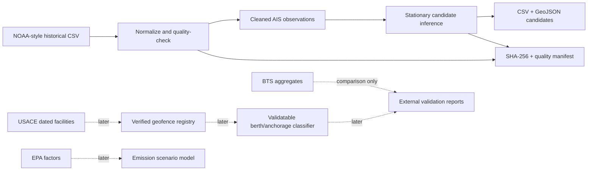

# Architecture — Current and Target

**Current (implemented / synthetic):** an offline Python CLI with canonical CSV normalization, provisional stationary segmentation, CSV/GeoJSON event export and SHA-256 input provenance. No private data, SaaS, live feed, UI or HTTP endpoint.

**Future open core:** source snapshot ledger, multi-day streaming partition, dated USACE geometries, uncertainty-aware classifier, independent evaluation, reference read-only API and historical map.

**Optional managed commercial layer:** scheduled and licensed feeds, customer-private TOS/PCS integrations, tenant-aware access, reports, uptime, billing and support. Must be separately approved after buyer and real-data gates.

Principles: UTC, EPSG:4326 lon/lat, explicitly versioned rules, `unknown` as a first-class state, external data licenses tracked per source. See ADRs.
