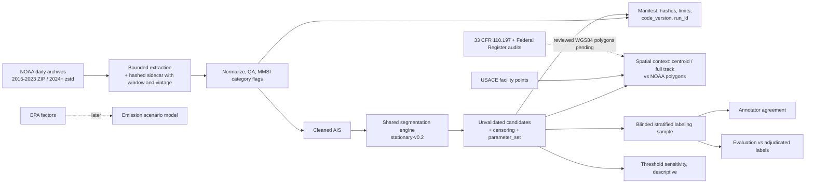

# Architecture — Current and Target

**Current (implemented; real-data use limited to source-pinned engineering smokes):** offline Python CLIs, no SaaS, live feed, UI or HTTP endpoint.

Every candidate stays `stationary_candidate` with `confidence_label=unvalidated`; spatial context, censoring flags and evaluation tooling never turn it into a verified berth, anchorage, wait or port call. Real labels have not been collected yet.

**Future open core:** source snapshot ledger, multi-day streaming partition, dated USACE geometries, uncertainty-aware classifier, independent evaluation, reference read-only API and historical map.

**Optional managed commercial layer:** scheduled and licensed feeds, customer-private TOS/PCS integrations, tenant-aware access, reports, uptime, billing and support. Must be separately approved after buyer and real-data gates.

Principles: UTC, EPSG:4326 lon/lat, explicitly versioned rules, `unknown` as a first-class state, external data licenses tracked per source. See ADRs.
